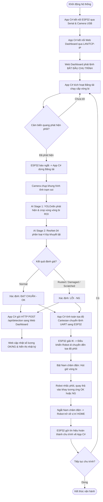

# 🏭 HỆ THỐNG KIỂM TRA & PHÂN LOẠI VÒNG BI TỰ ĐỘNG
## (AUTOMATED BEARING CLASSIFICATION SYSTEM)

Hệ thống tự động hóa công nghiệp kiểm tra và phân loại khuyết tật vòng bi kết hợp **Kiến trúc phân tán Edge - Cloud/Web**:
- **Trạm Điều Khiển Tại Chỗ (Edge Station - C# WinForms)**: Giao tiếp trực tiếp với phần cứng mạch điều khiển ESP32, thu nhận Camera DirectShow, chạy suy luận AI cục bộ 2 tầng (**YOLOv8 + ResNet-34 qua ONNX Runtime**) và điều khiển cánh tay Robot 4 bậc tự do (**4-DOF Arm**).
- **Hệ Thống Web Quản Lý & Giám Sát IoT (Central Web Dashboard - Python Flask)**: Kết nối với App C# qua **Mạng LAN nội bộ hoặc Internet (TCP/IP)**, cung cấp giao diện Web trực quan theo dõi thời gian thực, quản lý thống kê sản lượng OK/NG, lưu trữ lịch sử SQLite và điều khiển từ xa.
- **Phần Cứng & Cơ Điện Tử (Embedded & Mechatronics)**: Vi điều khiển **ESP32**, băng tải cấp phôi cảm biến quang NPN, mạch công suất cách ly và đầu gắp **nam châm điện (Electromagnet)**.

---

## 📑 Bảng Mục Lục
1. [Kiến Trúc Tổng Thể Hệ Thống](#-1-kiến-trúc-tổng-thể-hệ-thống)
2. [Quy Trình Hoạt Động (End-to-End Workflow)](#-2-quy-trình-hoạt-động-end-to-end-workflow)
3. [Chi Tiết Các Phân Hệ Công Nghệ](#-3-chi-tiết-các-phân-hệ-công-nghệ)
   - [3.1. Trạm điều khiển C# WinForms (Edge Control App)](#31-trạm-điều-khiển-c-winforms-edge-control-app)
   - [3.2. Web Quản Lý & Giám Sát IoT (Flask Dashboard Server)](#32-web-quản-lý--giám-sát-iot-flask-dashboard-server)
   - [3.3. Pipeline AI 2 tầng: YOLOv8n + ResNet-34 (ONNX Runtime)](#33-pipeline-ai-2-tầng-yolov8n--resnet-34-onnx-runtime)
   - [3.4. Vi điều khiển nhúng ESP32 & Động học Robot (Firmware)](#34-vi-điều-khiển-nhúng-esp32--động-học-robot-firmware)
   - [3.5. Phần cứng, Mạch PCB & Cơ khí (Hardware & Mechanics)](#35-phần-cứng-mạch-pcb--cơ-khí-hardware--mechanics)
4. [Giao Thức Truyền Thông & Kết Nối Đa Tầng](#-4-giao-thức-truyền-thông--kết-nối-đa-tầng)
   - [4.1. Giao tiếp LAN / TCP/IP (App C# $\leftrightarrow$ Web Quản lý)](#41-giao-tiếp-lan--tcpip-app-c--web-quản-lý)
   - [4.2. Giao tiếp Serial UART (App C# $\leftrightarrow$ Bo mạch ESP32)](#42-giao-tiếp-serial-uart-app-c--bo-mạch-esp32)
5. [Cấu Trúc Thư Mục Dự Án](#-5-cấu-trúc-thư-mục-dự-án)
6. [Hướng Dẫn Cài Đặt & Vận Hành](#-6-hướng-dẫn-cài-đặt--vận-hành)
7. [Kết Quả Đạt Được](#-7-kết-quả-đạt-được)

---

## 🏛️ 1. Kiến Trúc Tổng Thể Hệ Thống

Hệ thống được thiết kế theo mô hình phân tầng công nghiệp hiện đại (**Edge Controller $\leftrightarrow$ IoT Web Server**):

```
┌────────────────────────────────────────────────────────────────────────────────────────┐
│                   HỆ THỐNG GIÁM SÁT & QUẢN LÝ TRUNG TÂM (WEB IOT DASHBOARD)             │
│                                                                                        │
│   • Nền tảng: Python Flask / HTML5 / CSS3 / JavaScript / SQLite                        │
│   • Truy cập đa thiết bị: Trình duyệt PC, Tablet, Smartphone qua LAN / Internet        │
│   • Chức năng: Thống kê sản lượng Realtime, Giám sát Camera Snapshot, Lịch sử DB,       │
│                Điều khiển bắt đầu/dừng, Chế độ Mô phỏng / Thực tế                      │
└───────────────────────────────────────────▲────────────────────────────────────────────┘
                                            │
                                            │ MẠNG LAN / INTERNET (TCP/IP - HTTP REST API)
                                            │ • POST /api/detection (Kết quả AI, độ tin cậy)
                                            │ • POST /api/heartbeat (Trạng thái Online/Offline)
                                            │ • GET /api/status     (Trạng thái điều khiển)
                                            │ • GET /snapshot.jpg   (Hình ảnh camera trạm)
                                            ▼
┌────────────────────────────────────────────────────────────────────────────────────────┐
│                   TRẠM ĐIỀU KHIỂN & SUY LUẬN TẠI CHỖ (APP C# WINFORMS)                  │
│                                                                                        │
│   ┌────────────────────────────────────────┐  ┌─────────────────────────────────────┐  │
│   │        GIAO DIỆN WINFORMS (.NET 8)     │  │        ONNX RUNTIME AI PIPELINE     │  │
│   │  • Video Stream trực tiếp (OpenCV)     │  │  • Stage 1: yolo_bearing.onnx       │  │
│   │  • Mô phỏng Robot 3D (WPF/SharpDX)     │  │    (Định vị Bounding Box & Tâm)     │  │
│   │  • Quản lý cổng COM & cấu hình mạng    │  │  • Stage 2: resnet34_bearing.onnx   │  │
│   │  • Đồng bộ dữ liệu sang Web Dashboard  │  │    (Phân loại 4 lớp khuyết tật)     │  │
│   └────────────────────────────────────────┘  └─────────────────────────────────────┘  │
└───────────────────▲────────────────────────────────────────────▲───────────────────────┘
                    │                                            │
  (Camera Feed USB) │                                            │ Giao tiếp Serial UART
  DirectShow/OpenCV │                                            │ (Baud 9600/115200)
                    │                                            ▼
┌───────────────────┴───────┐                 ┌──────────────────────────────────────────┐
│  CAMERA QUAN SÁT TẠI TRẠM │                 │  BO MẠCH ĐIỀU KHIỂN TRUNG TÂM (ESP32)   │
│  • Độ phân giải cao       │                 │  • Thu nhận tín hiệu Cảm biến quang 24V  │
│  • Tiêu cự chuẩn buồng soi│                 │  • Giải thuật Động học nghịch (4-DOF IK) │
└───────────────────────────┘                 │  • Giao tiếp I2C điều khiển PCA9685      │
                                              │  • Đóng cắt MOSFET Băng tải & Nam châm   │
                                              └────────────────────┬─────────────────────┘
                                                                   │ (PWM 50Hz & Công suất)
                                                                   ▼
                                              ┌──────────────────────────────────────────┐
                                              │      CƠ CẤU CHẤP HÀNH NGOẠI VI           │
                                              │  • Động cơ Servo MG996R (Joint 1, 2, 3)  │
                                              │  • Micro Servo SG90 (Joint 4 Wrist)      │
                                              │  • Nam châm điện từ tính gắp phôi        │
                                              │  • Động cơ DC kéo Băng tải cấp phôi      │
                                              │  • Cảm biến quang phát hiện vị trí phôi  │
                                              └──────────────────────────────────────────┘
```

---

## 🔄 2. Quy Trình Hoạt Động (End-to-End Workflow)



---

## 🛠️ 3. Chi Tiết Các Phân Hệ Công Nghệ

### 3.1. Trạm Điều Khiển C# WinForms (Edge Control App)
*Thư mục mã nguồn: `software/DashBoardBearing/`*
- **Nền tảng**: `.NET 8.0 Windows Forms` kết hợp `WPF Interop` (`ElementHost`).
- **Giao tiếp phần cứng**:
  - Giao tiếp nối tiếp **Serial UART** (`System.IO.Ports`) đa luồng với ESP32: tự động kết nối lại khi mất tín hiệu, xử lý tập lệnh không đồng bộ không gây khóa giao diện.
  - Thu nhận hình ảnh trực tiếp qua `OpenCvSharp4` và `AForge.Video.DirectShow`.
- **Mô phỏng 3D thời gian thực**: Sử dụng `HelixToolkit.Wpf` và `SharpDX` mô phỏng trực quan chuyển động 4 khớp của Robot theo phản hồi thực tế từ ESP32.
- **Client LAN TCP/IP**:
  - Đóng vai trò Client gửi dữ liệu giám sát (`HttpClient`) lên Web Dashboard.
  - Cung cấp HTTP Endpoint nội bộ để Web Dashboard có thể đọc ảnh snapshot camera hiện tại.

### 3.2. Web Quản Lý & Giám Sát IoT (Flask Dashboard Server)
*Thư mục mã nguồn: `software/RobotBearingDashboard/`*
- **Nền tảng**: Python 3.10+, Flask, SQLite (`bearing.db`), HTML5/CSS3/JavaScript.
- **Tính năng trọng tâm**:
  - **Giám sát trực quan**: Hiển thị ảnh chụp trực tiếp từ trạm kiểm tra, nhãn phân loại, độ tin cậy và trạng thái chu trình.
  - **Thống kê sản lượng thời gian thực**: Biểu đồ trực quan và bộ đếm tổng sản phẩm, số lượng Đạt chuẩn (OK), các nhóm lỗi (Rỉ sét, Hư nắp, Khuyết tật bề mặt).
  - **Trạng thái phần cứng (Heartbeat)**: Giám sát tình trạng Online/Offline của module AI, Camera và mạch ESP32.
  - **Điều khiển từ xa**: Cho phép người quản trị ra lệnh Bắt đầu (`start`), Tạm dừng (`stop`), Đặt lại dữ liệu (`reset`) và chọn chế độ `real` (thực tế) hoặc `simulation` (mô phỏng).
  - **Lưu trữ & Xuất dữ liệu**: Tự động lưu nhật ký chi tiết vào SQLite và hỗ trợ trích xuất lịch sử phân loại.

### 3.3. Pipeline AI 2 Tầng: YOLOv8n + ResNet-34 (ONNX Runtime)
Hệ thống sử dụng cơ chế xử lý phân tầng nhằm tối ưu đồng thời tốc độ và độ chính xác:

| Tiêu chí | Giai đoạn 1 (Stage 1 - Detection) | Giai đoạn 2 (Stage 2 - Classification) |
| :--- | :--- | :--- |
| **Mô hình** | **YOLOv8n (Nano)** | **ResNet-34 (Deep Residual Net)** |
| **Vai trò** | Định vị Bounding Box & tọa độ tâm phôi $(X_c, Y_c)$ | Phân tích cấu trúc vi khuyết tật bề mặt |
| **Kích thước đầu vào** | $640 \times 640 \times 3$ | $224 \times 224 \times 3$ (Vùng ROI cắt từ BBox) |
| **Số lượng nhãn** | 1 lớp: `bearing` | 4 lớp: `normal`, `damaged_shield`, `rusted`, `surface_damage` |
| **Độ chính xác** | **Precision**: 98.9% \| **mAP@50**: **99.46%** | **Độ chính xác tổng**: **97.45%** \| **Macro F1**: **97.18%** |
| **Thời gian thực thi** | ~15 – 25 ms | ~8 – 15 ms |
| **Triển khai tại App C#** | `Microsoft.ML.OnnxRuntime` (`yolo_bearing.onnx`) | `Microsoft.ML.OnnxRuntime` (`resnet34_bearing.onnx`) |

#### Chi tiết độ chính xác phân loại 4 lớp (Tập Test độc lập 235 mẫu):
- `normal` (Đạt chuẩn $\rightarrow$ **OK**): Precision **97.7%**, Recall **91.3%**, F1 **94.4%**.
- `damaged_shield` (Hư nắp chắn bụi $\rightarrow$ **NG**): Precision **97.7%**, Recall **100.0%**, F1 **98.8%**.
- `rusted` (Gỉ sét oxy hóa $\rightarrow$ **NG**): Precision **97.3%**, Recall **99.1%**, F1 **98.2%**.
- `surface_damage` (Trầy xước/khuyết tật mặt lăn $\rightarrow$ **NG**): Precision **97.3%**, Recall **97.3%**, F1 **97.3%**.

### 3.4. Vi Điều Khiển Nhúng ESP32 & Động Học Robot (Firmware)
*Thư mục mã nguồn: `firmware/`*
- **Vi điều khiển**: ESP32-WROOM-32D (2 nhân Xtensa 240MHz).
- **Môi trường phát triển**: PlatformIO Core / C++ Framework Arduino.
- **Động học nghịch (Inverse Kinematics - IK)**:
  - Giải phương trình động học giải tích xác định góc 4 khớp $\theta_1, \theta_2, \theta_3, \theta_4$ từ tọa độ đích $(X, Y, Z)$ gửi từ App C#.
  - Kiểm tra điều kiện biên không gian làm việc (`OUT OF WORKSPACE`) và tránh điểm kỳ dị (`SINGULARITY`).
- **Máy trạng thái điều khiển (FSM)**: `IDLE`, `WAIT_SENSOR`, `MOVE_PICK`, `MAG_ON`, `MOVE_PLACE`, `MAG_OFF`, `HOME`, `ERROR`.
- **Giao tiếp phần cứng ngoại vi**:
  - Giao tiếp I2C Master tới IC tạo xung PWM PCA9685 (tần số 50Hz, phân giải 12-bit).
  - Đọc tín hiệu ngắt từ cảm biến quang qua bộ cách ly quang Opto PC817.
  - Điều khiển tầng kích MOSFET đóng ngắt động cơ băng tải và cuộn hút nam châm điện.

### 3.5. Phần Cứng, Mạch PCB & Cơ Khí (Hardware & Mechanics)
*Thư mục thiết kế: `hardware/`*
- **Cơ cấu tay máy 4-DOF**:
  - Thiết kế 3D bằng SolidWorks (`SLDASM`, `STEP`).
  - Khớp 1 (Đế), Khớp 2 (Vai), Khớp 3 (Khuỷu): Sử dụng Servo kim loại lực kéo cao **MG996R**.
  - Khớp 4 (Cổ tay xoay đầu gắp): Sử dụng Micro Servo **SG90**.
  - Đầu gắp: Sử dụng **Nam châm điện (Electromagnet)** hút giữ bề mặt vòng bi chắc chắn, tích hợp mạch dập xung ngược Flyback Diode.
- **Mạch điện tử điều khiển (PCB Hardware)**:
  - Thiết kế hoàn chỉnh trên **KiCad EDA** (`robot4dof.kicad_sch`, `robot4dof.kicad_pcb`).
  - Khối nguồn hạ áp cách ly: XL4015 (5A) cấp riêng cho hệ thống Servo, XL1509 và AMS1117 cấp cho mạch logic ESP32 nhằm triệt tiêu nhiễu sụt áp khi khởi động động cơ.
- **Băng tải & Cảm biến**:
  - Băng tải đai cao su nguồn 24V tốc độ ổn định.
  - Cảm biến thu phát quang học NPN 24V định vị phôi dừng chính xác tại buồng chụp.

---

## 📡 4. Giao Thức Truyền Thông & Kết Nối Đa Tầng

```
┌────────────────────┐            Mạng LAN / TCP-IP (HTTP REST)            ┌──────────────────────┐
│  Web Quản Lý IoT   │ ◄─────────────────────────────────────────────────► │    App C# WinForms   │
│  (Flask Dashboard) │   POST /api/detection, POST /api/heartbeat,...      │    (Edge Control)    │
└────────────────────┘                                                     └──────────┬───────────┘
                                                                                      │
                                                                   Cáp Serial (UART)  │ Cổng COM Nối Tiếp
                                                                   Baud 9600 / 115200 │ 8-N-1
                                                                                      ▼
                                                                           ┌──────────────────────┐
                                                                           │  Bo Mạch Điều Khiển  │
                                                                           │       (ESP32)        │
                                                                           └──────────────────────┘
```

### 4.1. Giao Tiếp LAN / TCP/IP (App C# $\leftrightarrow$ Web Quản Lý)

Kết nối thông qua giao thức HTTP REST API qua mạng LAN nội bộ (hoặc Internet TCP/IP):

| Endpoint | Phương thức | Bên gửi | Dữ liệu truyền (Payload JSON) | Chức năng |
| :--- | :---: | :---: | :--- | :--- |
| `/api/detection` | `POST` | App C# $\rightarrow$ Web | `{"category": "OK", "confidence": 0.975, "source": "ai", "cycle_id": 102}` | Gửi kết quả phân loại vòng bi |
| `/api/heartbeat` | `POST` | App C# $\rightarrow$ Web | `{"ai_online": true, "camera_online": true, "esp_online": true}` | Cập nhật trạng thái phần cứng |
| `/api/status` | `GET` | Web $\leftrightarrow$ App C# | Trả về JSON trạng thái hệ thống, chế độ chạy và số lượng | Đồng bộ trạng thái giao diện |
| `/api/control` | `POST` | Web $\rightarrow$ App C# | `{"action": "start"}` (hoặc `"stop"`, `"reset"`, `"real"`, `"demo"`) | Gửi lệnh điều khiển từ xa |
| `/snapshot.jpg` | `GET` | Web $\rightarrow$ App C# | Trả về luồng ảnh JPEG khung hình hiện tại của camera | Hiển thị hình ảnh trạm soi trên Web |

### 4.2. Giao Tiếp Serial UART (App C# $\leftrightarrow$ Bo Mạch ESP32)
- **Thông số truyền**: Baudrate: `9600 bps` (hoặc `115200 bps`), Data Bits: `8`, Parity: `None`, Stop Bits: `1`, Ký tự ngắt dòng: `\n`.

#### Bảng Lệnh Từ App C# $\rightarrow$ ESP32:
| Cú pháp lệnh | Ý nghĩa | Mô tả |
| :--- | :--- | :--- |
| `START` | Bắt đầu chu trình nạp lệnh | Khởi động hàng đợi chuyển động |
| `MOV <x> <y> <z>` | Di chuyển đầu gắp đến tọa độ | Tọa độ điểm gắp hoặc điểm thả phôi (mm) |
| `MAG <1\|0>` | Đóng/Ngắt nam châm điện | `MAG 1`: Hút giữ phôi \| `MAG 0`: Thả phôi |
| `HOME` | Về vị trí chờ an toàn | Đưa 4 khớp về góc an toàn mặc định |
| `CONV <1\|0>` | Đóng/Ngắt băng tải | Điều khiển động cơ băng tải chạy/dừng |
| `STOP` | Dừng khẩn cấp | Dừng toàn bộ chuyển động ngay lập tức |

#### Bản Tin Phản Hồi Từ ESP32 $\rightarrow$ App C#:
| Bản tin phản hồi | Ý nghĩa |
| :--- | :--- |
| `SENSOR_TRIGGERED` | Tín hiệu cảm biến quang ngắt báo phôi đã đến trạm dừng |
| `A <J1> <J2> <J3> <J4>` | Góc quay hiện tại của 4 khớp servo (chu kỳ 50ms để render 3D) |
| `CYCLE_DONE <id>` | Báo hoàn thành chu trình gắp thả thành công |
| `IK ERROR: OUT OF WORKSPACE` | Cảnh báo tọa độ phôi nằm ngoài bán kính vươn tới của robot |

---

## 📂 5. Cấu Trúc Thư Mục Dự Án

```
BEARING-CLASSIFICATION-SYSTEM/
│
├── firmware/                              # Firmware nhúng điều khiển ESP32
│   ├── platformio.ini                     # Cấu hình PlatformIO & thư viện phụ thuộc
│   ├── include/                           # Thư viện header C++ (.hpp)
│   │   ├── CLI.hpp                        # Bộ thông dịch lệnh Serial UART
│   │   ├── control.hpp                    # Cấu hình I2C PCA9685 & xung servo
│   │   └── kinematics.hpp                 # Giải thuật Động học nghịch (IK 4-DOF)
│   └── src/                               # Mã nguồn C++ triển khai
│       ├── main.cpp                       # Điểm khởi chạy, hàm setup() & loop()
│       ├── CLI.cpp                        # Xử lý chuỗi lệnh nhận từ App C#
│       ├── control.cpp                    # Điều khiển PWM, MOSFET băng tải & nam châm
│       └── kinematics.cpp                 # Thuật toán tính góc các khớp
│
├── hardware/                              # Thiết kế cơ khí CAD và mạch điện tử PCB
│   ├── cad/                               # File mô hình 3D SolidWorks (.SLDASM, .STEP)
│   │   ├── Assem1.SLDASM                  # Lắp ráp tổng thể cánh tay Robot 4-DOF
│   │   ├── base.SLDPRT                    # Chi tiết bệ đỡ xoay
│   │   ├── arm bar.SLDPRT                 # Cụm cánh tay chịu lực
│   │   ├── magnet.SLDPRT                  # Gá giữ nam châm điện
│   │   └── mg996R_v2.step                 # Mô hình 3D chuẩn servo MG996R
│   └── pcb/                               # Thiết kế bo mạch KiCad EDA
│       ├── robot4dof.kicad_sch            # Sơ đồ nguyên lý mạch điều khiển
│       ├── robot4dof.kicad_pcb            # Bản vẽ layout bo mạch in
│       └── robot4dof_gerber/              # Tệp Gerber phục vụ gia công sản xuất
│
├── software/                              # Toàn bộ phần mềm hệ thống máy tính
│   │
│   ├── DashBoardBearing/                  # [EDGE] Ứng dụng điều khiển trung tâm C# WinForms
│   │   ├── DashBoardBearing.sln           # Visual Studio Solution (.NET 8.0)
│   │   ├── DashBoardBearing.csproj        # Cấu hình dependencies & NuGet Packages
│   │   ├── CameraManager.cs               # Bắt hình camera, OpenCV & gọi ONNX Runtime
│   │   ├── SerialManager.cs               # Giao tiếp nối tiếp COM/UART với ESP32
│   │   ├── RoundedPanel.cs                # Component giao diện phẳng hiện đại
│   │   ├── FormHome.cs                    # Màn hình camera live, nhận diện & gửi dữ liệu Web
│   │   ├── FormRobot.cs                   # Màn hình tích hợp mô phỏng Robot 3D (WPF/SharpDX)
│   │   ├── FormSetting.cs                 # Cấu hình cổng COM, Camera và IP Web Dashboard
│   │   ├── FormLog.cs                     # Ghi nhật ký vận hành tại chỗ
│   │   └── Model/                         # Trọng số mô hình AI xuất chuẩn ONNX
│   │       ├── yolo_bearing.onnx          # Model Stage 1: Phát hiện BBox vòng bi
│   │       └── resnet34_bearing.onnx      # Model Stage 2: Phân loại 4 lớp khuyết tật
│   │
│   └── RobotBearingDashboard/             # [WEB IOT] Ứng dụng Web Quản Lý & Giám Sát
│       └── RobotBearingDashboard/
│           ├── app.py                     # Máy chủ backend Python Flask & REST API
│           ├── requirements.txt           # Thư viện Flask, requests
│           ├── bearing.db                 # Cơ sở dữ liệu SQLite lưu trữ lịch sử
│           ├── templates/
│           │   └── index.html             # Giao diện Web Dashboard thời gian thực
│           ├── static/                    # CSS, JS, hình ảnh giao diện Web
│           ├── send_ai_example.py         # Script Python mẫu gửi dữ liệu test API
│           └── README.md                  # Hướng dẫn chi tiết phân hệ Web Dashboard
│
├── training/                              # Mã nguồn huấn luyện & nghiên cứu AI (PyTorch)
│   ├── configs/config.yaml                # Siêu tham số huấn luyện
│   ├── models/class_mapping.json          # Bảng ánh xạ ID nhãn sang tên lỗi
│   ├── weights/                           # Checkpoint trọng số tối ưu (.pt, .pth)
│   ├── tools/                             # Tool cắt ROI, gán nhãn, tiền xử lý dữ liệu
│   ├── training/                          # Script huấn luyện YOLOv8 & Fine-tune ResNet-34
│   ├── main.py                            # Script chạy thực nghiệm độc lập trên Python
│   └── requirements.txt                   # Thư viện Python (torch, torchvision, ultralytics)
│
├── NCKH_REQUIREMENT.md                    # Bảng theo dõi các nội dung hoàn thiện báo cáo NCKH
└── README.md                              # Tài liệu hướng dẫn tổng thể dự án
```

---

## 🚀 6. Hướng Dẫn Cài Đặt & Vận Hành

### 6.1. Chuẩn Bị Môi Trường
1. **Phần cứng**: Máy tính chạy Windows 10/11, bo mạch ESP32, bộ đổi nguồn 24V (băng tải) và 5V-6V (servo), cáp nối USB-UART, camera trạm soi.
2. **Phần mềm phát triển**:
   - Visual Studio 2022 (cài gói **.NET Desktop Development**).
   - .NET 8.0 SDK.
   - Python 3.10 trở lên.
   - VS Code có cài extension **PlatformIO IDE**.

---

### 6.2. Nạp Firmware Cho Bo Mạch ESP32
1. Mở thư mục `firmware/` bằng VS Code.
2. Cắm cáp USB nối ESP32 vào máy tính.
3. Nhấn nút **PlatformIO: Upload** trên thanh trạng thái để biên dịch và nạp firmware.

---

### 6.3. Khởi Chạy Web Quản Lý (Flask Web Dashboard)
1. Mở terminal (PowerShell) và chuyển vào thư mục Web Dashboard:
   ```powershell
   cd software/RobotBearingDashboard/RobotBearingDashboard
   ```
2. Tạo môi trường ảo và cài đặt thư viện:
   ```powershell
   py -m venv .venv
   .\.venv\Scripts\Activate.ps1
   pip install -r requirements.txt
   ```
3. Khởi chạy Web Server:
   ```powershell
   python app.py
   ```
4. Truy cập giao diện trên trình duyệt web:
   ```
   http://127.0.0.1:5000
   ```
   *(Hoặc truy cập qua địa chỉ IP mạng LAN của máy chủ: `http://192.168.x.x:5000`)*.

---

### 6.4. Khởi Chạy Ứng Dụng C# WinForms (Edge Control Station)
1. Mở `software/DashBoardBearing/DashBoardBearing.sln` bằng Visual Studio 2022.
2. Đảm bảo cấu hình đường dẫn IP Web Dashboard trong phần cấu hình mạng (mặc định: `http://127.0.0.1:5000` hoặc IP LAN của máy chủ).
3. Kiểm tra các mô hình AI ONNX đã nằm đúng trong thư mục `software/DashBoardBearing/Model/`:
   - `yolo_bearing.onnx`
   - `resnet34_bearing.onnx`
4. Chọn cấu hình **Release \| x64** và nhấn **Start (F5)** để khởi chạy ứng dụng.

---

### 6.5. Vận Hành Đồng Bộ Toàn Hệ Thống
1. **Trên App C# WinForms**:
   - Vào tab **Setting**: Chọn cổng COM của ESP32 (ví dụ: `COM3`, baudrate `9600`), nhấn **Connect Serial**.
   - Chọn Camera soi phôi trong danh sách và nhấn **Start Camera**.
   - Bật kết nối đồng bộ dữ liệu tới **Web Dashboard**.
2. **Trên Web Dashboard**:
   - Kiểm tra nhịp tim phần cứng: biểu tượng **AI Online**, **Camera Online**, **ESP Online** chuyển sang màu xanh.
   - Chọn chế độ **Thực tế (Real Mode)** và nhấn **Bắt đầu (Start)**.
3. **Chu trình tự động**:
   - Băng tải chạy cấp vòng bi vào buồng soi.
   - Khi cảm biến quang ngắt, băng tải dừng lại.
   - Camera chụp ảnh, App C# suy luận AI 2 tầng (YOLOv8 + ResNet-34).
   - App C# tự động gửi bản tin phân loại qua mạng LAN sang Web Dashboard để ghi log và thống kê.
   - App C# truyền lệnh gắp tới ESP32; Robot gắp thả vòng bi vào đúng khay phân loại (Khay OK hoặc Khay NG).
   - Sau khi hoàn thành, robot trở về vị trí Home và băng tải tiếp tục chạy cấp sản phẩm mới.

---

## 🏆 7. Kết Quả Đạt Được

- ✅ **Kiến trúc hệ thống phân tán hoàn chỉnh**: Kết hợp linh hoạt giữa khả năng điều khiển cứng thời gian thực của C# WinForms và khả năng giám sát từ xa đa nền tảng qua mạng LAN của Web IoT Flask.
- ✅ **Độ tin cậy nhận diện cao**: Mô hình AI 2 tầng đạt độ chính xác **97.45%**, phân loại chuẩn xác 4 trạng thái vòng bi công nghiệp.
- ✅ **Vận hành an toàn & đồng bộ**: Cơ chế khóa liên động giữa cảm biến quang, băng tải và máy trạng thái robot giúp loại bỏ nguy cơ va chạm cơ khí và lỗi kẹt phôi.
- ✅ **Khả năng mở rộng công nghiệp**: Dễ dàng tích hợp thêm các trạm kiểm tra mới vào cùng một Web Dashboard quản lý thông qua giao thức mạng TCP/IP tiêu chuẩn.

---
*Dự án thuộc Đề tài Nghiên cứu Khoa học Sinh viên - Khoa Tự động hoá, Trí tuệ nhân tạo và Hệ thống thông minh, Trường Đại học Điện lực.*
