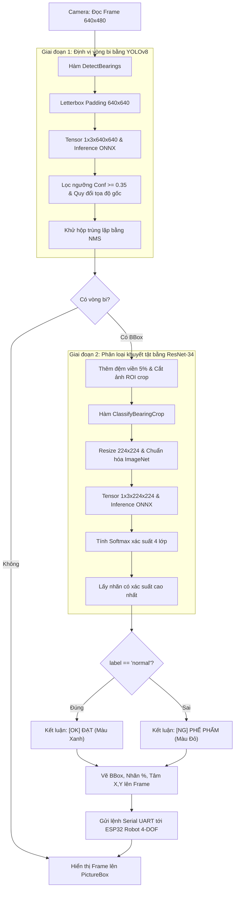

# Hướng Dẫn Chi Tiết Mã Nguồn Nhận Diện & Phân Loại C# WinForms (`detect.cs`)

Tài liệu này giải thích chi tiết kiến trúc, từng hàm và từng quy trình xử lý trong mã nguồn [detect.cs](file:///d:/robot_4_dof_iot/NCKH_Phan_loai_vong_bi/csharp/detect.cs) của ứng dụng C# Windows Forms.

---

## 1. Sơ Đồ Quy Trình Xử Lý Tổng Thể

Trong một chu kỳ xử lý khung hình (Frame Cycle ~ 33ms):



---

## 2. Giải Thích Chi Tiết Từng Hàm Trong Mã Nguồn

### 2.1. Hàm `InitModelsAndHardware()` (Khởi Tạo Hệ Thống)
**Vị trí**: Dòng 48 - 86 trong `detect.cs`  
**Mục đích**: Chuẩn bị tất cả tài nguyên phần mềm và phần cứng trước khi bước vào vòng lặp xử lý.

- **Bước 1: Nạp 2 mô hình ONNX**:
  - Gọi hàm `FindModelPath("yolo_bearing.onnx")` và `FindModelPath("resnet34_bearing.onnx")`.
  - Khởi tạo 2 phiên làm việc `InferenceSession` độc lập. ONNX Runtime sẽ tự động tối ưu đồ thị tính toán (Graph Optimization) cho CPU/GPU.
- **Bước 2: Kết nối Camera**:
  - Dùng `VideoCapture(0, VideoCaptureAPIs.DSHOW)`: Sử dụng driver DirectShow của Windows để camera khởi động nhanh và ổn định.
  - Thiết lập độ phân giải `640x480` và `BufferSize = 1` (chỉ lưu 1 frame mới nhất trong bộ đệm để không bị trễ hình - Zero Latency).
- **Bước 3: Mở cổng Serial ESP32**:
  - Cấu hình baudrate chuẩn `115200 bps` kết nối với board ESP32 điều khiển robot 4-DOF.
- **Bước 4: Khởi động Timer quét hình**:
  - `Interval = 33` mili-giây, tương đương tốc độ ~30 khung hình/giây (FPS).

---

### 2.2. Hàm `FindModelPath(string fileName)` (Định Tuyến File Mô Hình)
**Vị trí**: Dòng 91 - 108 trong `detect.cs`  
**Mục đích**: Giúp ứng dụng chạy linh hoạt ở mọi môi trường (chạy trong Visual Studio Debug/Release, chạy từ thư mục gốc hoặc đóng gói ra file `.exe`).

- Hàm sẽ tự động tìm kiếm file `.onnx` theo thứ tự ưu tiên:
  1. Thư mục hiện hành (`fileName`)
  2. Thư mục `csharp/fileName`
  3. Thư mục `weights/onnx/fileName`
  4. Thư mục đầu ra của file `.exe` (`AppDomain.CurrentDomain.BaseDirectory`)
- Nếu không tìm thấy ở bất kỳ đâu, hàm sẽ ném ra ngoại lệ thông báo cụ thể cho người lập trình.

---

### 2.3. Hàm `DetectBearings(Mat frame)` (Phát Hiện Vòng Bi Bằng YOLOv8)
**Vị trí**: Dòng 191 - 281 trong `detect.cs`  
**Input**: Khung hình camera gốc `Mat frame` (640x480).  
**Output**: Danh sách tọa độ các hình chữ nhật bao quanh vòng bi `List<Rect>`.

Hàm thực hiện 4 bước toán học & thị giác máy tính:

#### Bước 1: Kỹ thuật Letterbox Resizing
- Vòng bi là vật thể thể hình tròn. Nếu dùng hàm `Resize` thông thường ép từ `640x480` thành hình vuông `640x640`, hình tròn của vòng bi sẽ bị méo thành hình elip, làm giảm độ chính xác của mạng YOLO.
- **Cách giải quyết (Letterbox)**:
  - Tính hệ số tỷ lệ co giãn: `scale = min(640 / 640, 640 / 480) = 1.0` (theo chiều rộng) hoặc `0.75` (theo chiều cao).
  - Giữ nguyên tỷ lệ, phần diện tích dư ra sẽ được đệm màu xám công nghiệp `Scalar(114, 114, 114)` ở trên và dưới.

#### Bước 2: Chuẩn hóa Tensor đầu vào
- Chuyển không gian màu từ **BGR** (chuẩn mặc định OpenCV) sang **RGB** (chuẩn huấn luyện mạng nơ-ron).
- Chia giá trị mỗi điểm ảnh cho `255.0f` để đưa dải giá trị từ `[0, 255]` về `[0.0, 1.0]`.
- Nạp vào đối tượng `DenseTensor<float>` kích thước 4 chiều: `[BatchSize=1, Channels=3, Height=640, Width=640]`.

#### Bước 3: Phân tích kết quả đầu ra của YOLOv8 (Output Parsing)
- Mô hình YOLOv8 khi xuất ra ONNX cho bài toán 1 lớp (`bearing`) có tensor đầu ra hình dạng: `[1, 5, 8400]`.
  - **8400**: Tổng số anchor box dự đoán được sinh ra trên 3 tầng đặc trưng (feature maps: 80x80 + 40x40 + 20x20).
  - **5 giá trị** tại mỗi anchor box gồm:
    - Index 0: Tọa độ tâm $c_x$ (theo kích thước 640x640)
    - Index 1: Tọa độ tâm $c_y$ (theo kích thước 640x640)
    - Index 2: Chiều rộng $w$ (theo kích thước 640x640)
    - Index 3: Chiều cao $h$ (theo kích thước 640x640)
    - Index 4: Điểm tin cậy (Confidence score) của lớp `bearing`.
- Duyệt qua 8400 điểm, nếu `conf >= 0.35f`:
  - Quy đổi tọa độ ngược lại kích thước ảnh gốc bằng cách trừ khoảng đệm `padX, padY` rồi chia cho `scale`.
  - Tính góc trên-trái: $x_1 = c_x - w/2$, $y_1 = c_y - h/2$.

#### Bước 4: Khử hộp trùng lặp (Non-Maximum Suppression - NMS)
- Khi một vòng bi xuất hiện, mạng có thể dự đoán nhiều bounding box chồng lấn nhau.
- Gọi hàm `CvDnn.NMSBoxes(boxes, confidences, 0.35f, 0.45f, out indices)` để loại bỏ các box trùng lặp (ngưỡng giao nhau IoU = 0.45), chỉ giữ lại duy nhất 1 box bao trọn vòng bi với độ tin cậy cao nhất.

---

### 2.4. Hàm `ClassifyBearingCrop(Mat crop)` (Phân Loại Bằng ResNet-34)
**Vị trí**: Dòng 286 - 338 trong `detect.cs`  
**Input**: Vùng ảnh crop của vòng bi `Mat crop`.  
**Output**: Cặp giá trị gồm nhãn lỗi và độ tin cậy: `(string label, float conf)`.

Gồm 4 bước:

#### Bước 1: Tiền xử lý ảnh Crop
- Chuyển `crop` sang hệ màu RGB.
- Resize ảnh về kích thước cố định `224 x 224` (kích thước chuẩn đầu vào của ResNet).

#### Bước 2: Chuẩn hóa ImageNet (Normalization)
Mô hình ResNet-34 được huấn luyện dựa trên bộ trọng số ImageNet, do đó bắt buộc phải chuẩn hóa theo công thức:
$$\text{Pixel Chuẩn Hóa} = \frac{\frac{\text{Pixel}}{255.0} - \text{Mean}}{\text{Std}}$$
- $\text{Mean} = [0.485, 0.456, 0.406]$
- $\text{Std} = [0.229, 0.224, 0.225]$

#### Bước 3: Inference và tính Softmax
- Đưa tensor vào `resnetSession.Run(inputs)` để lấy về mảng 4 giá trị **Logits** thô (chưa phải xác suất %).
- Áp dụng công thức hàm **Softmax ổn định số học (Numerically Stable Softmax)**:
  $$P_i = \frac{e^{z_i - \max(z)}}{\sum_{j} e^{z_j - \max(z)}}$$
  (Trừ đi $\max(z)$ để tránh hiện tượng tràn số thực `float overflow` khi số mũ $e^z$ quá lớn).

#### Bước 4: Kết luận nhãn
- Duyệt qua mảng xác suất `probs[4]` để tìm chỉ số `bestIdx` có xác suất cao nhất:
  - `0`: **`damaged_shield`** (Hư nắp chắn bụi)
  - `1`: **`normal`** (Bình thường / Đạt chuẩn)
  - `2`: **`rusted`** (Bị gỉ sét)
  - `3`: **`surface_damage`** (Rỗ, trầy xước bề mặt)

---

### 2.5. Hàm `ProcessFrame()` (Điều Phối Chính Vòng Lặp)
**Vị trí**: Dòng 114 - 186 trong `detect.cs`  
**Mục đích**: Là trái tim điều phối toàn bộ chu trình xử lý cho mỗi khung hình camera:

1. **Đọc khung hình**: `capture.Read(frame)`.
2. **Tìm vòng bi**: Gọi `DetectBearings(frame)`.
3. **Mở rộng vùng cắt (Padding 5%)**:
   - Khi YOLO nhận diện, khung viền bounding box có thể ôm quá sát mép ngoài của vòng bi.
   - Code tự động cộng thêm $5\%$ lề ra xung quanh:
     ```csharp
     int padX = (int)(bbox.Width * 0.05);
     int padY = (int)(bbox.Height * 0.05);
     ```
     Điều này đảm bảo mạng ResNet-34 nhìn thấy được toàn bộ gờ vành ngoài và nắp chắn bụi mà không bị mất góc.
4. **Phân loại**: Gọi `ClassifyBearingCrop(crop)`.
5. **Quyết định OK / NG**:
   ```csharp
   bool isOk = (label == "normal");
   ```
6. **Hiển thị giao diện**:
   - Nếu `isOk == true`: Vẽ khung **Xanh Lá** kèm chữ `[OK] DAT (98%)`.
   - Nếu `isOk == false`: Vẽ khung **Đỏ** kèm chữ `[NG] RUSTED (99%)`.
   - Vẽ điểm tròn tại tâm vòng bi: $X_c = X + W/2$, $Y_c = Y + H/2$.
7. **Gửi lệnh Serial điều khiển Robot (ESP32)**:
   - Gửi chuỗi định dạng qua cổng COM:
     ```
     CMD:OK,320,240\n
     CMD:NG,410,180\n
     ```
   - ESP32 nhận chuỗi này, phân tích tọa độ $(X, Y)$ và quyết định điều khiển servo gắp vòng bi bỏ vào khay `OK` hoặc khay `NG`.
8. **Hiển thị hình ảnh**: Chuyển đổi sang `Bitmap` hiển thị mượt mà trên WinForms `PictureBox`.

---

### 2.6. Hàm `OnFormClosing()` (Giải Phóng Bộ Nhớ)
**Vị trí**: Dòng 343 - 351 trong `detect.cs`  
**Mục đích**: 
- Dừng `Timer`.
- Giải phóng Camera (`capture.Release()`).
- Hủy các vùng nhớ unmanaged của ONNX Runtime (`yoloSession.Dispose()`, `resnetSession.Dispose()`).
- Đóng cổng `SerialPort`.
- Tránh tình trạng ứng dụng đã tắt nhưng camera hoặc cổng COM vẫn bị khóa chiếm dụng ngầm.
